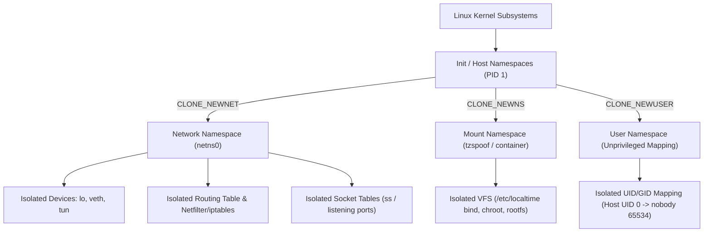
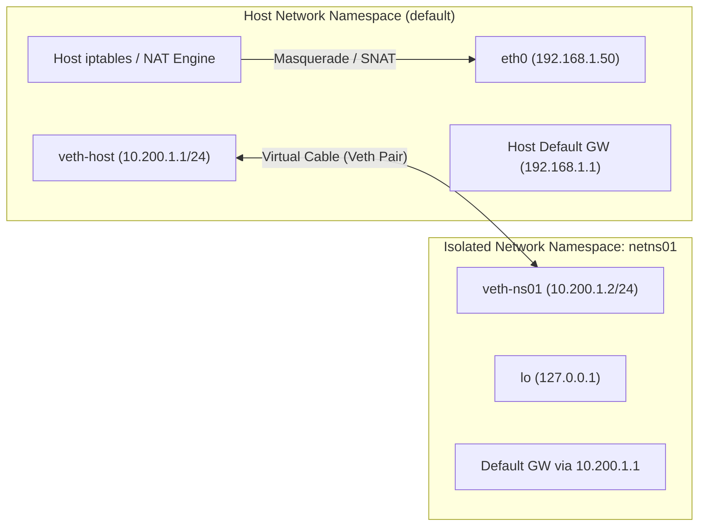
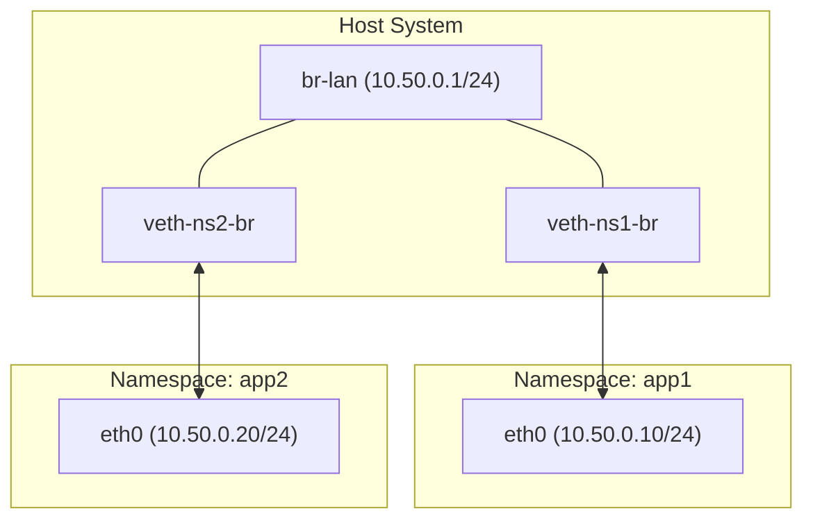
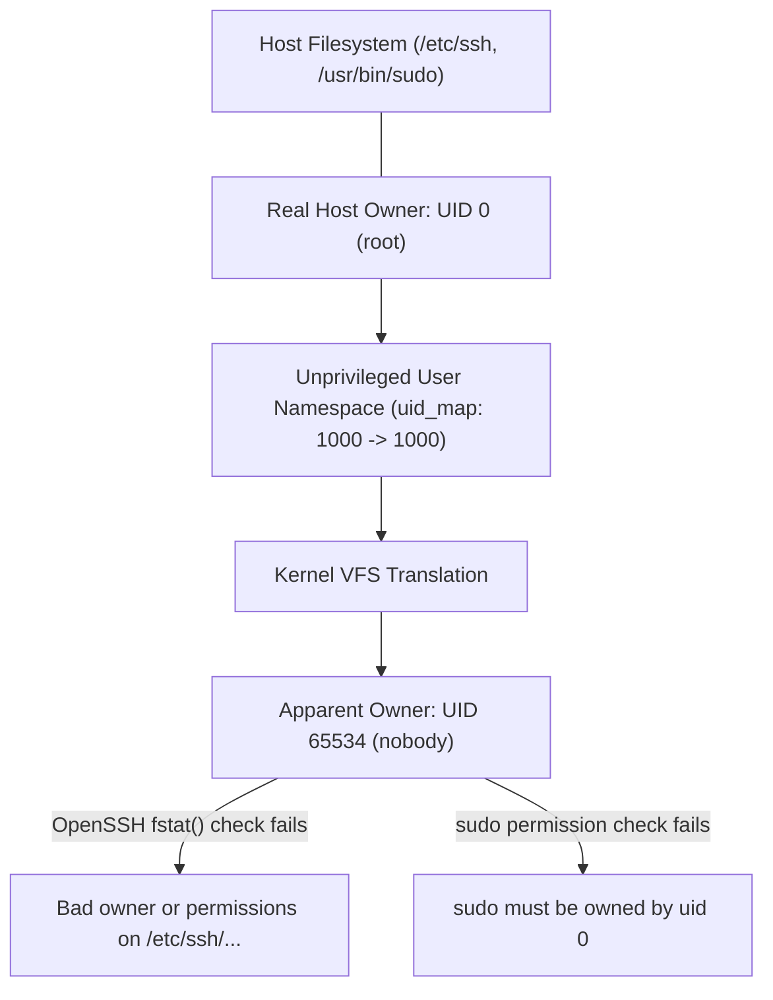

# Linux Namespaces & Network Namespaces: Architecture, Operations & Internals

> [!NOTE]
> This guide details how Linux namespaces operate under the hood, how to manage **Network Namespaces** (`CLONE_NEWNET`) using both CLI tools (`ip netns`, `unshare`, `nsenter`) and C system calls, and how namespace interactions (like unprivileged User Namespaces and UID mapping) affect production tools.

---

## 1. Linux Namespaces Architecture

Linux Namespaces are a kernel feature that partitions kernel resources so that one set of processes sees one set of resources while another set of processes sees an entirely different set. They form the foundational building block of Linux containers (Docker, containerd, Kubernetes, Podman).



### The 8 Linux Namespace Types

| Namespace | Clone Flag | Isolated Resource | Introduced In |
| :--- | :--- | :--- | :--- |
| **Mount** | `CLONE_NEWNS` | Mount points and filesystem hierarchy | Linux 2.4.19 |
| **UTS** | `CLONE_NEWUTS` | Hostname and NIS domain name | Linux 2.6.19 |
| **IPC** | `CLONE_NEWIPC` | System V IPC, POSIX message queues | Linux 2.6.19 |
| **PID** | `CLONE_NEWPID` | Process IDs (PID 1 inside namespace) | Linux 2.6.24 |
| **Network** | `CLONE_NEWNET` | Network devices, IP stacks, routes, ports, iptables | Linux 2.6.29 |
| **User** | `CLONE_NEWUSER` | User and group IDs, capabilities, root privilege | Linux 3.8 |
| **Cgroup** | `CLONE_NEWCGROUP` | Cgroup root directory view | Linux 4.6 |
| **Time** | `CLONE_NEWTIME` | Boot and monotonic clocks | Linux 5.6 |

Every process on Linux points to its active namespaces via symlinks in `/proc/<PID>/ns/`:

```bash
ls -l /proc/$$/ns/
```
Output:
```text
lrwxrwxrwx 1 user user 0 cgroup -> 'cgroup:[4026531835]'
lrwxrwxrwx 1 user user 0 ipc -> 'ipc:[4026531839]'
lrwxrwxrwx 1 user user 0 mnt -> 'mnt:[4026531841]'
lrwxrwxrwx 1 user user 0 net -> 'net:[4026531840]'
lrwxrwxrwx 1 user user 0 pid -> 'pid:[4026531836]'
lrwxrwxrwx 1 user user 0 user -> 'user:[4026531837]'
lrwxrwxrwx 1 user user 0 uts -> 'uts:[4026531838]'
```
The numbers in brackets (e.g., `[4026531840]`) are the kernel's internal inode numbers identifying that namespace instance.

---

## 2. Network Namespaces (`CLONE_NEWNET`)

A network namespace provides a completely isolated network subsystem. Inside a new network namespace, you get:
1. **Dedicated Network Devices:** Physical interfaces (`eth0`), virtual interfaces (`veth*`, `tun*`, `tap*`, `wg*`), and a separate loopback interface (`lo`).
2. **Dedicated IP Routing Tables:** Distinct default gateways and routing entries (`ip route`).
3. **Dedicated Firewall / Packet Filtering:** Independent `iptables`, `nftables`, and `ebtables` rule sets.
4. **Dedicated Socket Tables:** Port allocations are isolated. Port `80` can be bound inside `netns0` without conflicting with port `80` on the host.
5. **Dedicated `/proc/net` & `/sys/class/net` hierarchy.**



---

## 3. Working with Network Namespaces: Hands-On Guide

### Step 1: Creating and Managing Network Namespaces

The `ip netns` command suite uses bind mounts in `/var/run/netns/` to keep namespaces persistent even when no processes are currently running in them.

```bash
# 1. Create two network namespaces
sudo ip netns add blue
sudo ip netns add red

# 2. List all persistent network namespaces
ip netns list

# 3. Execute a command inside a namespace
sudo ip netns exec blue ip link list
```

> [!IMPORTANT]
> **The Loopback Trap:** Whenever a network namespace is created, its loopback interface (`lo`) is in the `DOWN` state by default! Any application attempting to bind to `127.0.0.1` or `localhost` will fail until you activate it.
>
> ```bash
> sudo ip netns exec blue ip link set lo up
> sudo ip netns exec red ip link set lo up
> ```

---

### Step 2: Connecting Namespaces with a Virtual Ethernet Pair (`veth`)

A `veth` pair behaves like a physical patch cable connecting two network interfaces: whatever enters one end immediately exits the other.

```bash
# 1. Create a veth pair on the host
sudo ip link add veth-blue type veth peer name veth-blue-peer

# 2. Move one end of the pair into the 'blue' namespace
sudo ip link set veth-blue-peer netns blue

# 3. Inside the namespace, rename it to a clean standard name (e.g., eth0)
sudo ip netns exec blue ip link set veth-blue-peer name eth0

# 4. Assign IP addresses
# Host end:
sudo ip addr add 10.100.1.1/24 dev veth-blue
sudo ip link set veth-blue up

# Namespace end:
sudo ip netns exec blue ip addr add 10.100.1.2/24 dev eth0
sudo ip netns exec blue ip link set eth0 up

# 5. Verify connectivity across the namespace boundary
ping -c 2 10.100.1.2
sudo ip netns exec blue ping -c 2 10.100.1.1
```

---

### Step 3: Giving Internet Access to a Network Namespace

To allow processes inside the namespace to reach the internet via the host's physical uplink:

```bash
# 1. Add default gateway inside the namespace pointing to host's veth IP
sudo ip netns exec blue ip route add default via 10.100.1.1

# 2. Enable IP forwarding on the Linux host
sudo sysctl -w net.ipv4.ip_forward=1

# 3. Configure iptables NAT (Masquerading) on the host interface (e.g. eth0 or wlan0)
# Replace 'eth0' with your host physical outbound interface:
HOST_IF=$(ip route show default | awk '{print $5}')
sudo iptables -t nat -A POSTROUTING -s 10.100.1.0/24 -o "$HOST_IF" -j MASQUERADE
sudo iptables -A FORWARD -i veth-blue -o "$HOST_IF" -j ACCEPT
sudo iptables -A FORWARD -i "$HOST_IF" -o veth-blue -m state --state RELATED,ESTABLISHED -j ACCEPT

# 4. Configure DNS for the namespace
# The 'ip netns exec' tool automatically mounts /etc/netns/<NAME>/resolv.conf over /etc/resolv.conf
sudo mkdir -p /etc/netns/blue
echo "nameserver 1.1.1.1" | sudo tee /etc/netns/blue/resolv.conf

# 5. Test internet access and DNS resolution from inside the namespace
sudo ip netns exec blue ping -c 2 1.1.1.1
sudo ip netns exec blue curl -s -I https://github.com | head -n 1
```

---

### Step 4: Connecting Multiple Namespaces using a Linux Bridge



```bash
# 1. Create the bridge
sudo ip link add br-lan type bridge
sudo ip addr add 10.50.0.1/24 dev br-lan
sudo ip link set br-lan up

# 2. Create peer for NS1
sudo ip link add veth-app1 type veth peer name veth-app1-peer
sudo ip link set veth-app1-peer netns app1
sudo ip link set veth-app1 master br-lan
sudo ip link set veth-app1 up

sudo ip netns exec app1 ip link set lo up
sudo ip netns exec app1 ip link set veth-app1-peer name eth0
sudo ip netns exec app1 ip addr add 10.50.0.10/24 dev eth0
sudo ip netns exec app1 ip link set eth0 up
sudo ip netns exec app1 ip route add default via 10.50.0.1
```

---

## 4. Namespaces at the System Call Level (C Architecture)

Linux provides three primary system calls to interact with namespaces:

| Syscall | Purpose | CLI Equivalent |
| :--- | :--- | :--- |
| `clone()` | Spawns a new child process directly into newly created namespaces | `unshare <cmd>` |
| `unshare()` | Detaches the calling thread from current namespaces into new ones | `unshare --fork` |
| `setns()` | Attaches the calling thread into an existing namespace via `/proc/<PID>/ns/<TYPE>` | `nsenter` |

### Minimal C Program: Spawning an Isolated Network & User Namespace

Save as `netns_demo.c`:

```c
#define _GNU_SOURCE
#include <sched.h>
#include <stdio.h>
#include <stdlib.h>
#include <unistd.h>
#include <sys/wait.h>
#include <fcntl.h>
#include <string.h>

static void write_file(const char *path, const char *content) {
    int fd = open(path, O_WRONLY);
    if (fd >= 0) {
        write(fd, content, strlen(content));
        close(fd);
    }
}

int main(int argc, char *argv[]) {
    uid_t real_uid = getuid();
    gid_t real_gid = getgid();

    printf("[*] Parent PID: %d, UID: %d\n", getpid(), real_uid);

    /*
     * CLONE_NEWUSER: Allows unprivileged user to create namespaces without root
     * CLONE_NEWNET: Creates a fresh, isolated network stack
     * CLONE_NEWNS: Creates a fresh mount namespace
     */
    if (unshare(CLONE_NEWUSER | CLONE_NEWNET | CLONE_NEWNS) == -1) {
        perror("[-] unshare failed");
        return 1;
    }

    /* Map UID and GID */
    write_file("/proc/self/setgroups", "deny");

    char map_buf[64];
    snprintf(map_buf, sizeof(map_buf), "%u %u 1\n", real_uid, real_uid);
    write_file("/proc/self/uid_map", map_buf);

    snprintf(map_buf, sizeof(map_buf), "%u %u 1\n", real_gid, real_gid);
    write_file("/proc/self/gid_map", map_buf);

    printf("[+] Successfully entered isolated Network & User Namespace!\n");

    /* Execute command or spawn shell */
    char *cmd = (argc > 1) ? argv[1] : "/bin/bash";
    char *args[] = { cmd, NULL };
    execvp(cmd, args);

    perror("execvp");
    return 1;
}
```

---

## 5. The Critical Trap: User Namespaces, UID Mapping & Sudo/SSH

The exact issue encountered during `tzspoof` illustrates the most common pitfall when combining namespaces:

### Why Unprivileged Users Need `CLONE_NEWUSER`
In Linux, unprivileged processes cannot create mount (`CLONE_NEWNS`) or network (`CLONE_NEWNET`) namespaces directly. Doing so yields `EPERM` (Operation not permitted).
To bypass requiring `sudo`, utilities use `CLONE_NEWUSER`. In an unprivileged user namespace, the caller gains full capabilities (like `CAP_NET_ADMIN` and `CAP_SYS_ADMIN`) **within that user namespace**.

### The Unmapped Root Problem (`nobody` / UID 65534)
When writing `/proc/self/uid_map`, an unprivileged user can only map their own host UID:
```text
1000 1000 1
```
Because host UID `0` (`root`) is not mapped, the Linux kernel translates any file owned by host root into the system overflow UID:
```text
/proc/sys/fs/overflowuid  -->  65534 (nobody / nogroup)
```



### Why Applications Fail:
1. **OpenSSH (`ssh`, `git push` over SSH):**
   OpenSSH calls `fstat()` on included system config files (`/etc/ssh/ssh_config.d/*.conf`). It requires `st.st_uid == 0 || st.st_uid == getuid()`. Because it sees `65534`, it halts with `Bad owner or permissions`.
2. **`sudo` / Setuid Binaries:**
   - The Linux kernel strictly disables setuid execution (`MS_NOSUID`) inside user namespaces for security.
   - Sudo requires `/etc/sudo.conf` and `/usr/bin/sudo` to be owned by UID 0.

### The Solutions:
1. **Preload Interception (`libtzspoof.so`):**
   Intercept `fstat`, `fstatat`, `stat`, `lstat`, and `statx` via `LD_PRELOAD`. When `st_uid == 65534`, dynamically replace it with `0`. This makes OpenSSH see root ownership and succeed without weakening system security.
2. **Environment Mode (`-e` / `--env-only`):**
   When root actions or setuid binaries (`sudo`) are necessary, bypass namespaces and use standard environment variables (`$TZ`, `$LD_PRELOAD`).

---

## 6. Namespace Diagnostic & Inspection Cheat Sheet

| Task | Command |
| :--- | :--- |
| **List all network namespaces** | `ip netns list` |
| **List all system namespaces & owners** | `lsns` |
| **List network namespaces with PIDs** | `lsns -t net` |
| **Find namespace of a running process** | `readlink /proc/<PID>/ns/net` |
| **Identify which netns a PID belongs to** | `ip netns identify <PID>` |
| **Run a command inside an existing netns** | `ip netns exec <NAME> <COMMAND>` |
| **Enter a process's netns by PID** | `nsenter -t <PID> -n <COMMAND>` |
| **Enter all namespaces of a target PID** | `nsenter -t <PID> -a <COMMAND>` |
| **Inspect socket table inside a netns** | `sudo ip netns exec <NAME> ss -tulpn` |
| **Inspect routing table inside a netns** | `sudo ip netns exec <NAME> ip route show` |
| **Inspect iptables inside a netns** | `sudo ip netns exec <NAME> iptables -L -v -n` |
| **Delete persistent network namespace** | `sudo ip netns delete <NAME>` |
| **Remove orphaned netns file** | `sudo umount /var/run/netns/<NAME> && sudo rm /var/run/netns/<NAME>` |

---

## 7. WireGuard VPN Isolation inside a Network Namespace

One of the most practical production patterns for network namespaces is running a VPN client entirely inside an isolated network namespace. This creates an impenetrable **kill-switch**: processes inside the namespace can ONLY communicate through the VPN tunnel, and if the tunnel drops, no traffic can leak to the host network.

```bash
# 1. Create isolated namespace
sudo ip netns add vpn
sudo ip netns exec vpn ip link set lo up

# 2. Create WireGuard interface on host
sudo ip link add wg0 type wireguard

# 3. Move WireGuard interface into namespace
sudo ip link set wg0 netns vpn

# 4. Configure WireGuard credentials and IP inside namespace
sudo ip netns exec vpn wg setconf wg0 /etc/wireguard/wg0.conf
sudo ip netns exec vpn ip addr add 10.0.0.2/24 dev wg0
sudo ip netns exec vpn ip link set wg0 up
sudo ip netns exec vpn ip route add default dev wg0

# 5. Launch applications in VPN isolation
sudo ip netns exec vpn curl https://ifconfig.me
```
All host applications (browsers, IDEs, SSH) continue to use the normal physical internet connection, while any process executed with `ip netns exec vpn <app>` is strictly tunneled through WireGuard.
